<div align="center">


# تبيان · Tibyan

**تطبيق قرآن مجاني ومفتوح المصدر: مصحف، وتفسير، وتلاوة، وحفظ، وتسميع.**<br>
**A free, open-source Quran app: mushaf, tafsir, recitation, memorization and tasmee.**

[](LICENSE)
[](https://github.com/helalrules7/tibyan/releases)
[](#التحميل--download)
[](https://flutter.dev)
[](https://github.com/helalrules7/tibyan/actions/workflows/ci.yml)

[altibyan.app](https://altibyan.app) · [العربية](#العربية) · [English](#english)

</div>

<p align="center">
  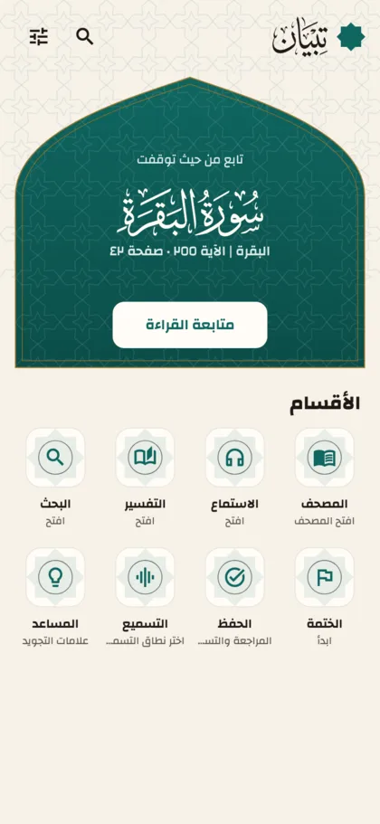
  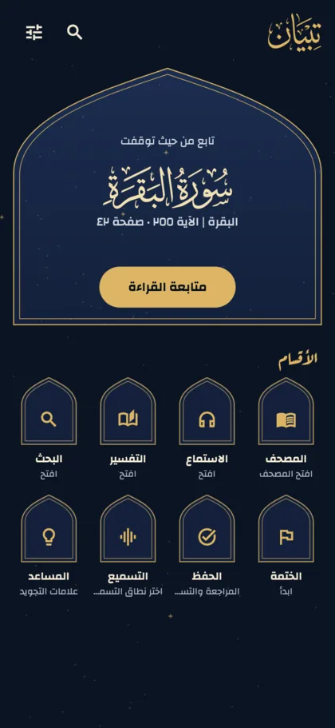
  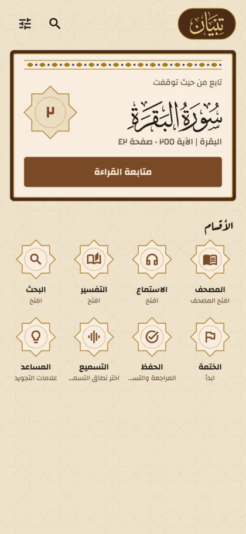
</p>

---

## العربية

### المميزات

- **المصحف:** طبعات حفص (المدينة الحديثة والقديمة 1405 والشمرلي)، وروايات ورش وقالون والدوري وشعبة، وأشكال تراثية متعددة، والتجويد الملوّن، والصفحتان المتقابلتان على الشاشات العريضة.
- **التلاوة:** قراء كثيرون، وتظليل الآية والكلمة مع الصوت، والتكرار والسرعة ومؤقت النوم، والتنزيل للاستماع بلا إنترنت.
- **التفسير ومعاني الكلمات:** التفسير الميسر والترجمات، ودراسة الكلمة، والمتشابهات، والنسخ والمشاركة نصا وصورة.
- **الحفظ والتسميع:** اختبار كلمة بكلمة، ومراجعة متباعدة، وخريطة الحفظ، وتسميع صوتي يعمل على جهازك.
- **الختمة والمسبحة:** مخطط الختمة وتذكيرها وتقاريرها، ودفتر التدبر، والمسبحة، وأدوات الشاشة الرئيسية.
- **للجميع:** وضع كبار السن، ودعم قارئ الشاشة، وواجهة عربية وإنجليزية، ونسخة احتياطية في ملف واحد.

### التحميل

التطبيق في مرحلة الاختبار:

| المنصة | الرابط |
|---|---|
| أندرويد | [اختبار Google Play](https://play.google.com/apps/internaltest/4701465992904267136)، أو APK من [GitHub Releases](https://github.com/helalrules7/tibyan/releases) |
| آيفون وآيباد | [TestFlight](https://testflight.apple.com/join/gxJ4rrdd) |
| ماك | من [GitHub Releases](https://github.com/helalrules7/tibyan/releases) |
| ويندوز ولينكس | من [GitHub Releases](https://github.com/helalrules7/tibyan/releases) (غير موقّعة) |

لتصلك الدعوة عند فتح الاختبار: [altibyan.app/beta](https://altibyan.app/beta)

### المبادئ

1. **مجاني بالكامل:** بلا إعلانات ولا مشتريات ولا اشتراكات.
2. **بلا تتبع:** لا حساب، ولا أدوات تحليلات. بياناتك على جهازك، وصوتك في التسميع لا يغادره. تقارير الأعطال اختيارية. التفاصيل في [سياسة الخصوصية](https://altibyan.app/privacy).
3. **لا يكتب الذكاء الاصطناعي أي محتوى ديني.** كل نص قرآن أو تفسير أو قراءات يأتي من مصدر موثق، ويظهر مصدره معه.
4. **لا محتوى علمي قبل مراجعة متخصص**، واسم المراجع يظهر عليه.
5. **كل مصدر مذكور وبإذن:** السجل في [`docs/DATA_SOURCES.md`](docs/DATA_SOURCES.md)، ونصوص الأذونات في [`docs/licenses/`](docs/licenses/).

### ساهم

- **صحّح توقيت التلاوة** بأذنك من المتصفح: [المحرر](https://helalrules7.github.io/tibyan/) و[الدليل](docs/TIMING_GUIDE.md). لا تحتاج خبرة برمجية.
- **علّم المواضع في صوت القراءات** إن كنت تعرفها: [الدليل](docs/QIRAAT_AUDIO.md).
- **سجّل تلاوتك لتدريب نموذج التسميع** على [train.altibyan.app](https://train.altibyan.app). التسجيلات تُنشر بترخيص CC BY 4.0.
- **الكود:** اقرأ [`CONTRIBUTING.md`](CONTRIBUTING.md).

---

## English

### Features

- **Mushaf:** Hafs editions (new Madina, old Madina 1405, Shamarly), the Warsh, Qalun, al-Duri and Shu'bah riwayat, several heritage styles, tajweed colouring, and two facing pages on wide screens.
- **Recitation:** many reciters, verse and word highlighting in sync with the audio, repeat, speed, sleep timer, and offline downloads.
- **Tafsir and word meanings:** al-Muyassar and translations, word study, similar verses (mutashabihat), copy and share as text or image.
- **Memorization and tasmee:** word-by-word tests, spaced review, a hifz map, and recitation checking that runs on your device.
- **Khatma and tasbih:** khatma planner, reminders and reports, a reflection journal, a tasbih counter, and home-screen widgets.
- **For everyone:** elderly mode, screen-reader support, Arabic and English interface, one-file backup.

### Download

Tibyan is in beta:

| Platform | Link |
|---|---|
| Android | [Google Play testing](https://play.google.com/apps/internaltest/4701465992904267136), or the APK on [GitHub Releases](https://github.com/helalrules7/tibyan/releases) |
| iPhone and iPad | [TestFlight](https://testflight.apple.com/join/gxJ4rrdd) |
| macOS | [GitHub Releases](https://github.com/helalrules7/tibyan/releases) |
| Windows and Linux | [GitHub Releases](https://github.com/helalrules7/tibyan/releases) (unsigned) |

Get an invite when testing opens: [altibyan.app/beta](https://altibyan.app/beta)

### Principles

1. **Completely free:** no ads, no purchases, no subscriptions.
2. **No tracking:** no account, no analytics. Your data stays on your device, and your voice never leaves it during tasmee. Crash reports are opt-in. See the [privacy policy](https://altibyan.app/privacy).
3. **No AI-written religious content.** Every Quran, tafsir or qiraat text comes from a verified source, shown with its credit.
4. **No scholarly content before review** by a qualified person, whose name is shown with it.
5. **Every source credited and permitted:** listed in [`docs/DATA_SOURCES.md`](docs/DATA_SOURCES.md), with license evidence in [`docs/licenses/`](docs/licenses/).

### Contribute

- **Fix recitation timings** by ear in your browser: [the editor](https://helalrules7.github.io/tibyan/) and [the guide](docs/TIMING_GUIDE.md). No programming needed.
- **Mark qiraat audio** if you know the qiraat: [the guide (Arabic)](docs/QIRAAT_AUDIO.md).
- **Record your recitation** to train the tasmee model at [train.altibyan.app](https://train.altibyan.app). Recordings are published under CC BY 4.0.
- **Code:** see [`CONTRIBUTING.md`](CONTRIBUTING.md).

---

## Screenshots

| | | |
|:-:|:-:|:-:|
|  | 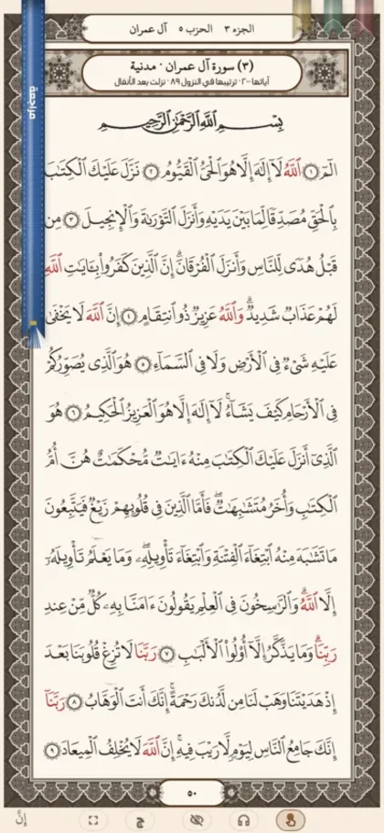 | 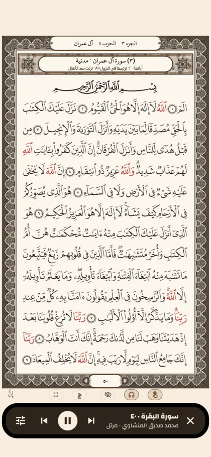 |
| المصحف · Mushaf | الفواصل · Bookmarks | التلاوة · Recitation |
| 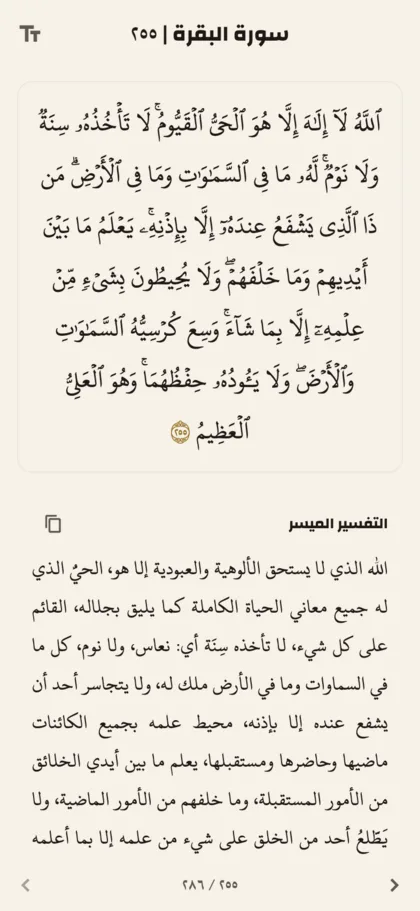 | 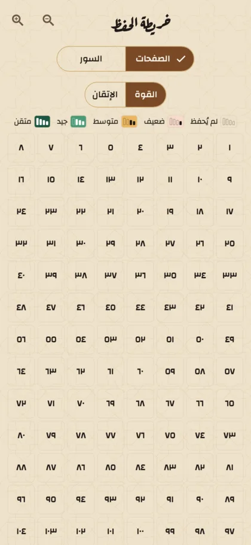 | 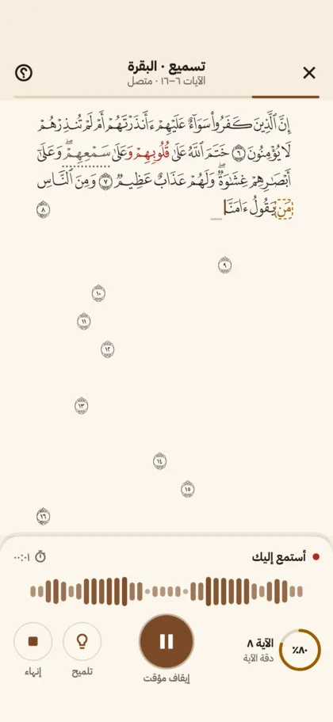 |
| التفسير · Tafsir | خريطة الحفظ · Hifz map | التسميع · Tasmee |
| 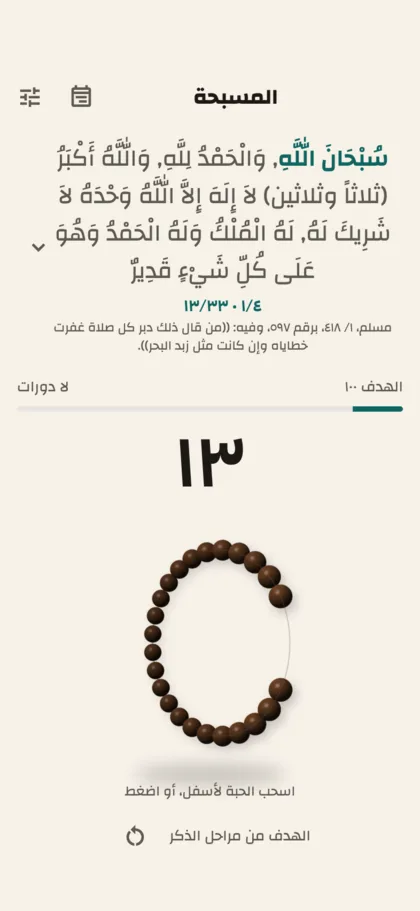 | 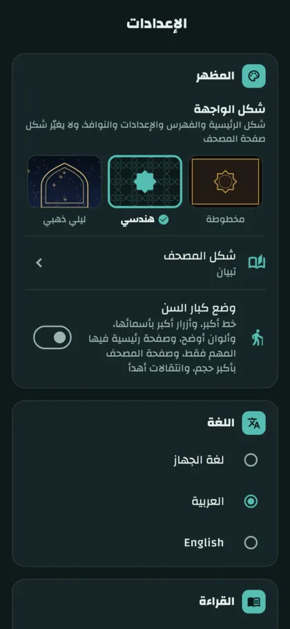 | |
| المسبحة · Tasbih | الإعدادات · Settings | |

<p align="center">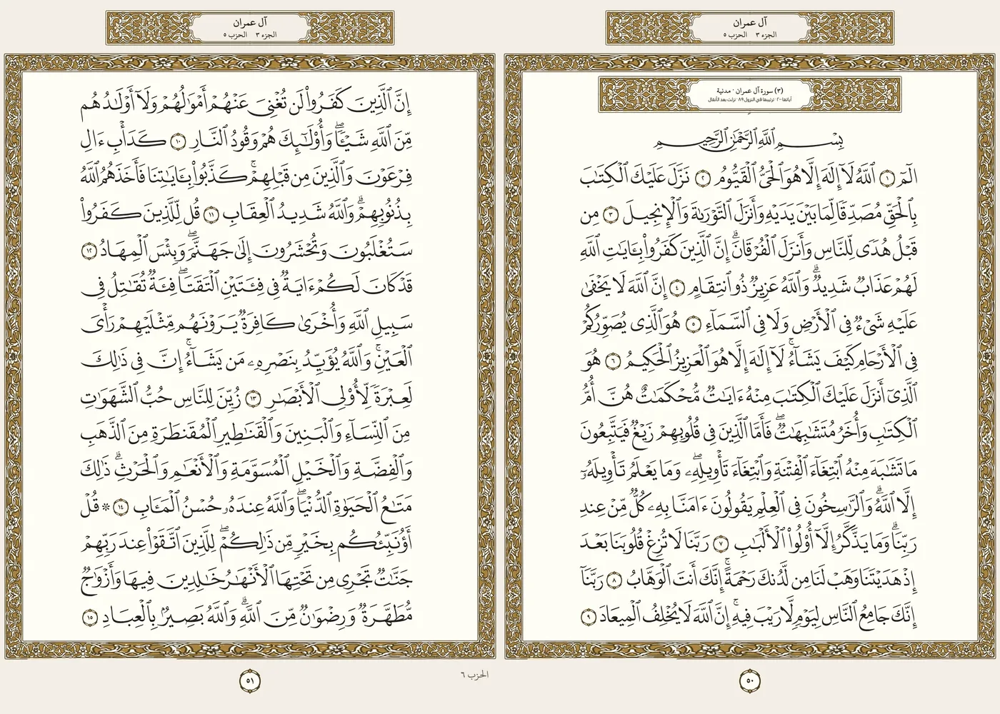<br>صفحتان متقابلتان على الحاسوب · Two facing pages on desktop</p>

---

## Build from source

Requirements: Flutter 3.47.5 (stable), Git LFS, Python 3. Per platform: Android SDK; Xcode (iOS, macOS); Visual Studio (Windows); GTK 3, libmpv and libcurl (Linux).

```sh
git lfs install
git clone https://github.com/helalrules7/tibyan.git
cd tibyan
flutter pub get
flutter run            # pick a device
flutter test
```

Optional: `cp .env.example .env` and run with `flutter run --dart-define-from-file=.env` to enable crash reporting or sync keys. `python3 tools/fetch_sources.py` downloads and verifies the raw data. Raw datasets and audio are never committed; the scripts in `tools/` rebuild them and check each file's SHA-256.

## Project structure

| Path | Contents |
|---|---|
| `lib/features/` | App screens, one folder per feature (mushaf, audio, tafsir, hifz, tasmee, tasbih, khatma…) |
| `lib/core/` | Theme tokens, settings, feature flags, routing, crash reporting |
| `lib/l10n/` | Arabic (template) and English strings |
| `assets/` | Themes, fonts (Git LFS), feature flags, content database |
| `apple/` | WidgetKit extensions for iOS and macOS |
| `apps/` | Scholarly review tool and recitation timing editor (web) |
| `data/` | Recitation timings as text (CC BY 4.0) |
| `tools/` | Reproducible data pipeline and release scripts |
| `training-platform/` | [train.altibyan.app](https://train.altibyan.app): voice donations for the tasmee model |
| `docs/` | Data sources, licenses, release process, plans |

## License

- **Code:** [GPL-3.0](LICENSE).
- **Content:** each dataset keeps its source's license, listed in [`docs/DATA_SOURCES.md`](docs/DATA_SOURCES.md). Data derived from OpenITI is CC BY-NC-SA 4.0, shipped separately from the code. KFGQPC fonts are distributed unmodified under the Complex's terms.
- **Recitation timings** in `data/timing/` and **voice recordings** from the training platform: CC BY 4.0.

Releases: [`docs/RELEASE.md`](docs/RELEASE.md) · Changelog: [`CHANGELOG.md`](CHANGELOG.md) · Security: [`SECURITY.md`](SECURITY.md)

## Follow · تابعنا

[Facebook](https://facebook.com/tibyanapp) · [Instagram](https://instagram.com/tibyanapp) · [TikTok](https://tiktok.com/@altibyanapp) · [YouTube](https://youtube.com/@altibyanApp) · [altibyan.app](https://altibyan.app) · info@altibyan.app
